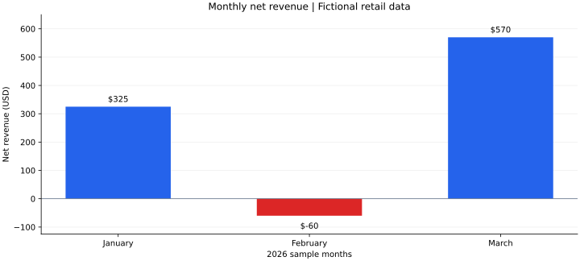

# Retail Sales Analytics

A Python and SQLite project that answers six retail business questions using a relational database, joins, common table expressions, and window functions.

**Tools:** Python · SQLite · SQL · Markdown reporting  
**Run:** Python 3.9+ or Thonny; no extra packages required.



## Sample findings

All customers and transactions are **fictional**. This is a learning project, not client work.

| Finding | Result |
| --- | ---: |
| Total net revenue | $835.00 |
| January net revenue | $325.00 |
| February net revenue | −$60.00 |
| March net revenue | $570.00 |
| Highest-revenue product | Monitor: $400.00 net |
| Highest net-spending customer | Customer D: $400.00 |
| Completed orders | 6 |

February's $200 refund exceeded its $140 in completed sales, producing negative net revenue. The Dock remains visible with $0 revenue because the product report uses a LEFT JOIN. These examples show why refunds and missing sales need explicit handling.

[View the complete six-query report](retail_sales_results.md).

## Run the project

1. Download `retail_sales_analytics.py` and open it in Thonny.
2. Click **Run**. No input or database setup is needed.
3. Read the results in the console or open `retail_sales_results.md` beside the script.

From a terminal:

```bash
python3 retail_sales_analytics.py
```

The program creates an in-memory SQLite database each run and replaces the Markdown report in its folder. It does not create or modify an existing database file.

## Business questions and SQL techniques

| Question | Technique |
| --- | --- |
| What are monthly gross sales, refunds, and net revenue? | GROUP BY, CASE, SUM |
| Which products generate net revenue, including unsold products? | LEFT JOIN, COALESCE |
| How do customers rank by net spending? | CTE, DENSE_RANK |
| Which customers have no completed purchases? | Correlated NOT EXISTS |
| What is average completed order value by region? | Aggregate order lines before AVG |
| How does net revenue accumulate by month? | CTE, SUM window function |

## Data model and definitions

The sample contains 5 customers, 5 products, 8 orders, and 10 order lines. Separate `customers`, `products`, `orders`, and `order_items` tables connect through primary and foreign keys. A `sales_lines` view applies the transaction rules consistently.

- Money is stored in integer cents and converted to dollars for reports.
- Canceled orders are excluded.
- Refunded orders contribute negative revenue. Refunds are assigned to the original order month because there is no separate refund date.
- Average order value includes completed orders only. Items are summed to the order level first to avoid averaging individual order lines.
- Customers without completed purchases means no order with `status='completed'` in this sample.

## Limitations

This small dataset illustrates query behavior; it does not support real business conclusions. Taxes, shipping, discounts, partial refunds, inventory costs, and multiple currencies are outside scope. Future extensions could add a dated returns table, larger datasets, and dashboard exports.

## AI assistance

ChatGPT assisted with code generation, debugging, and documentation. The schema, synthetic inputs, and SQL queries are included in one file so the results can be inspected and reproduced.
